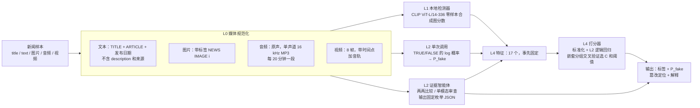
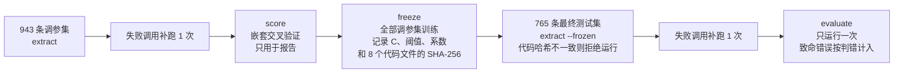

# PanoAgent v2 模型架构报告

v2 是一个独立的 Python 包，位于 [`panoagent_v2/`](../panoagent_v2/)，共约 1,400 行代码。它对 PanoFND 中的每条新闻（文本、图片、音频、视频的任意组合）输出以下内容：
- 真假标签，以及一个连续的 P(fake)；
- 篡改定位：哪个模态被判为篡改，哪几对模态之间存在冲突；
- 一段只根据证据生成的解释。

原来的 `panoagent`（v1）没有改动。v2 只复用了 v1 的数据加载、划分读取和 JSON 解析这三个工具函数。实验结果见 [EXPERIMENT_REPORT_v2_20261122.md](EXPERIMENT_REPORT_v2_20261122.md)。

## 1. 总体结构



| 层 | 文件 | 作用 |
|---|---|---|
| L0 媒体规范化 | `media.py`、`media_worker.py` | 给每个附件加标签，音频以原声输入，视频抽帧并提取音轨。解码在子进程中完成，缓存按文件内容的哈希生成 |
| L1 本地检测器 | `detectors.py` | CLIP 零样本"合成或编辑图片 vs 相机照片"分数，只作为特征，不直接下结论 |
| L2 证据层 | `client.py`、`prompts.py`、`agents.py` | 1 次单次调用，加上两两比较或单模态审查 |
| L3 检索 | 未启用 | 11/07 的实验显示，联网检索会把假新闻推向判真 |
| L4 打分 | `features.py`、`scorer.py` | 17 个特征，用逻辑回归打分，嵌套分组交叉验证 |
| 冻结与评测 | `evaluation.py`、`cli.py` | 冻结打分器、代码哈希保护、在最终测试集上只运行一次 |

## 2. L0：媒体规范化（`media.py`、`media_worker.py`）

**文本**
- 格式为 `TITLE: …`、`ARTICLE: …`、`PUBLICATION DATE: …`，最多 12,000 个字符。
- `description` 和 `source` 字段不进入任何提示词。`description` 会泄露标签，来源 URL 也会。

**图片**
- 每张图片前加标签 `[NEWS IMAGE i]`。
- 发送前重新编码为 JPEG，长边不超过 1,280 像素。

**音频**
- 直接输入原声，不再使用 v1 的 ASR 转写稿。
- 压缩为单声道、16 kHz、24 kbps 的 MP3，每 20 分钟切一段。
- 标签形如 `[NEWS AUDIO PART 1/2 | 00:00-20:00]`。

**视频**
- 按 `duration × (i + 0.5) / 8` 的时间点均匀抽 8 帧，长边不超过 768 像素，标签形如 `[VIDEO FRAME 3 @ 00:42]`。
- 同时提取音轨，标签形如 `[VIDEO SOUNDTRACK PART 1/1 | …]`。

**稳定性**
- 所有 PyAV 解码都在子进程里完成，并且同一时间只做一个解码。即使解码器崩溃（例如 1669 号视频会触发 0xC0000005 访问冲突），也只会把这一条样本标记为媒体错误，不会中断整个运行。
- 缓存键是文件内容的 SHA-256，而不是文件路径。文件被原地替换后，缓存会自动失效，这对应评审意见第 6 点。

## 3. L1：本地检测器（`detectors.py`）

- 使用本地已有的 CLIP ViT-L/14-336 权重。对每张图片或视频帧，计算它与 3 条"假"提示词和 3 条"真"提示词的相似度，取 softmax 后"假"提示词所占的概率。
- "假"提示词有：AI 生成、计算机合成、PS 篡改。"真"提示词有：相机拍摄、未经编辑的新闻照片、真实场景。
- 得到两个特征：图片的最大分数 `image_synth_max`，视频帧的最大分数 `frame_synth_max`。
- 实测作用很弱，去掉之后结果不变。更强的检测器（MiRAGe-Img、音频防伪模型 AASIST）需要下载权重，这一版没有包含。

## 4. L2：证据层（`client.py`、`prompts.py`、`agents.py`）

### 4.1 基础模型与调用方式
- 模型：qwen3.8-omni-flash，通过 DashScope 的 OpenAI 兼容接口调用，使用 SSE 流式输出。
- 参数：温度 0，seed 42，`reasoning_effort: none`，单次超时 300 秒，最多重试 4 次。
- 消息格式：先放任务提示，再放带标签的文本块，然后是每个附件，附件前紧跟它的标签。图片用 `image_url` 发送，音频用 `input_audio`（mp3）发送。

### 4.2 单次调用（每条样本 1 次）
- 系统提示词沿用论文里的 TRUE/FALSE 判断提示，输入与后续智能体完全相同。
- 只生成第一个 token，并读取它的 top-5 log 概率，P(fake) = P(FALSE) / (P(TRUE) + P(FALSE))。
- 得到的是连续分数，而不是硬标签，交给打分器使用。

### 4.3 证据智能体
- **调用计划**：只有一个模态时，做 1 次单模态审查；有 n 个模态时，对每一对模态各调用一次，共 C(n, 2) 次。每次调用只给模型看这两个模态，分别标为 SOURCE A 和 SOURCE B。
- 例如 text+image+audio 会做 3 次两两比较，再加 1 次单次调用，共 4 次 API 调用。

**两两比较的输出**（JSON 模式，只能从固定枚举中选）：

| 字段 | 取值 |
|---|---|
| `consistency` | consistent / conflict / unrelated / insufficient |
| `slot_checks`（最多 6 项） | field 为 number / person / organization / location / time / quote / event；status 为 match / mismatch / unverifiable |
| `a_integrity`、`b_integrity` | intact / manipulated / uncertain |
| `cues`、`summary` | 简短的观察依据和一句话总结 |

**单模态审查的输出**：`integrity`（intact / manipulated / uncertain）、`internal_consistency`（consistent / contradictory / uncertain）、`cues` 和 `summary`。

**提示词纪律**（对应评审意见第 4、5 点，由测试覆盖）：
- 模板里不预填默认值，模型无法照抄一个现成的 `"supported": true`。
- 不针对任何具体样本或实体打补丁。
- 字段缺失或取值非法时，记为 insufficient 或 uncertain，不往"真"的方向偏。

### 4.4 缓存
- 每个阶段的结果保存在 `cache/v2_stages/<model>/<id>/<stage>.json`。
- 缓存的指纹包括模型、提示词、调用参数，以及每个附件内容的哈希。
- 只有成功的调用会被复用，失败的调用下次运行时会重试。

## 5. L4：特征与打分器（`features.py`、`scorer.py`）

### 5.1 17 个特征（在看到任何结果之前固定）

| 类别 | 特征 |
|---|---|
| 模态 | `has_text`、`has_image`、`has_audio`、`has_video` |
| 单次调用 | `single_p_fake`，调用失败时取 0.5 |
| 检测器 | `image_synth_max`、`frame_synth_max` |
| 两两一致性 | `frac_conflict`、`frac_unrelated`、`any_conflict` |
| 槽位 | `slot_mismatch`、`slot_match`，计数，最多计到 6 |
| 完整性 | `frac_manipulated`、`any_manipulated`、`frac_integrity_uncertain` |
| 单模态 | `uni_contradictory` |
| 运行质量 | `failed_calls` |

### 5.2 打分器
- 模型：标准化后接 L2 正则的逻辑回归，`class_weight="balanced"`。
- 正则强度 C 从 {0.01, 0.03, 0.1, 0.3, 1.0} 中选择，阈值选在使内部折外预测的 Balanced Acc. 最高的位置。
- **嵌套、分组的交叉验证**：外层 5 折、内层 4 折，使用 `StratifiedGroupKFold`，按新闻来源分组（`PanoFNDDataset.group_key`），并按标签分层。C 和阈值只在内层选择，报告的每一条预测都来自既没见过该样本、也没见过同一来源样本的模型。这对应评审意见第 5、6 点。
- **最终冻结的模型**：用全部 943 条调参集训练，得到 C = 1.0、阈值 0.549。

权重最大的标准化系数依次是：`any_manipulated` +1.61、`single_p_fake` +1.04、`frac_integrity_uncertain` +0.77、`frac_conflict` +0.68、`frac_unrelated` +0.63。

### 5.3 输出
- **定位**（`localise`）：按被判为 manipulated 的票数给模态排序，并列出 consistency 为 conflict 的模态对。
- **解释**（`explain`）：只把已有证据拼接成一段话，包括冲突的模态对、被判为篡改的模态、不匹配的槽位，以及单次调用的分数。不额外调用模型，不会编造内容。

## 6. 冻结与最终测试协议（`evaluation.py`）



- 主系统是"全部 17 个特征"，在运行最终测试集之前写进 `frozen.json`。
- 对照组"单次调用（v2 输入）"的阈值同样在调参集上冻结，为 0.223。
- 对最终测试集运行 `extract` 时必须带 `--frozen` 参数，否则直接退出。只要冻结后任何特征相关代码改动过，程序同样拒绝运行。
- 全流程由 [`scripts/v2_overnight.py`](../scripts/v2_overnight.py) 无人值守地执行。它支持断点续跑，运行期间会请求系统不要自动睡眠。

## 7. 运行方式

```powershell
# 调参集：提取证据（凭据只从 .secrets 读入进程环境变量，结束后清除）
powershell -ExecutionPolicy Bypass -File scripts\run_v2.ps1 -Split splits\half_eval_seed42.json -Partition train -Output runs\v2_tuning943_features.jsonl
# 交叉验证打分
.venv\Scripts\python.exe -m panoagent_v2.cli score --dataset fakenewsDataSet --features runs\v2_tuning943_features.jsonl --output-dir runs\v2_tuning943_score
# 冻结打分器
.venv\Scripts\python.exe -m panoagent_v2.cli freeze --dataset fakenewsDataSet --features runs\v2_tuning943_features.jsonl --output runs\v2_frozen\frozen.json
# 最终测试集：只运行一次
powershell -ExecutionPolicy Bypass -File scripts\run_v2.ps1 -Split splits\final_holdout_clean_765_20261031.json -Partition test -Output runs\v2_holdout765_features.jsonl -Frozen runs\v2_frozen\frozen.json
.venv\Scripts\python.exe -m panoagent_v2.cli evaluate --dataset fakenewsDataSet --features runs\v2_holdout765_features.jsonl --frozen runs\v2_frozen\frozen.json --output-dir runs\v2_holdout765_eval
# 测试
.venv\Scripts\python.exe -m pytest tests_v2
```

## 8. v1 到 v2 的主要变化

| 方面 | v1（`panoagent`） | v2（`panoagent_v2`） |
|---|---|---|
| 音频 | ASR 转写稿 | 原声音频 |
| 媒体标注 | 无标签，按顺序拼接 | 每个附件都带标签和时间点 |
| 视频 | 16 帧 | 8 帧，带时间点，加音轨 |
| 推理结构 | 6 个阶段串联，最后由法官判定 | 单次调用的概率，加上两两比较和单模态证据 |
| 最终判定 | 规则、槽位保护强制改判、离线校准 | 事先固定的特征，加嵌套分组交叉验证训练的逻辑回归 |
| 提示词 | 含预填默认值和针对个别样本的补丁 | 只用固定枚举，不预填、不打补丁 |
| 检索 | 联网搜索（实验显示有害） | 不启用 |
| 缓存 | 以文件路径为键 | 以文件内容的哈希为键 |
| 解码容错 | 解码器崩溃会中断整个运行 | 子进程隔离，崩溃只影响单条样本 |
| 最终测试集 Balanced Acc. | 70.9%（v1 输入的单次调用，直接输出，未调阈值） | 83.6%（2026-11-24 更正：差距同时包含输入、提示词、阈值和打分器的变化） |

## 9. 已知限制
- 智能体在最终测试集上没有比同输入的单次调用表现更好（+0.2 个点 [−2.0, +2.6]），在调参集交叉验证上高 4.1 个点，两者不一致。它现在的主要价值在于定位和解释，而定位准确率还没有评估。
- CLIP 检测器偏弱。
- 没有文本模态的样本也带有标题，标题算作文本。所以 `has_text` 在调参集上几乎恒为 1，标注为单模态的音频、图片样本实际是两个模态，只有纯文本样本会做单模态审查。
- 最终测试集有 94 条的标题在调参集中出现过，去掉后 v2 为 82.7%。
- 冻结哈希只覆盖 8 个代码文件，不含 `cli.py`、`evaluation.py` 和从 `panoagent` 引用的函数。
- 长音频样本的请求体可能超过 10 MB，网络较差时容易上传超时。
- 打分器更容易把假新闻判成真的：最终测试集里 FAKE 召回 76.4%，REAL 召回 90.8%。
